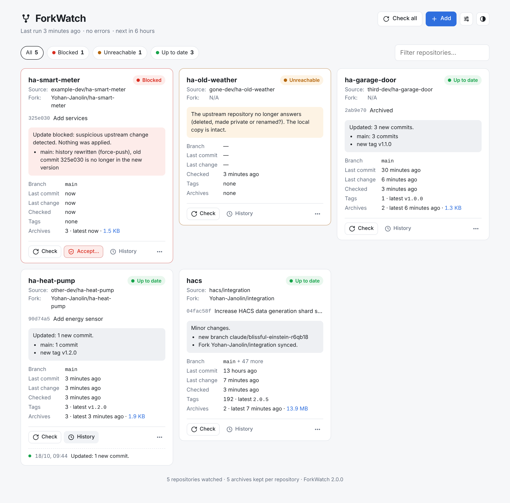

# ForkWatch

ForkWatch keeps a safe copy of the Git repositories you depend on, such as Home Assistant integrations, in case their authors delete them or break them.

On each check, it:

- **detects** whether the upstream repository changed, using a lightweight `git ls-remote` that downloads nothing when nothing moved;
- **analyses** the change before applying it, and **blocks** anything suspicious on the main branch:
  - history rewritten by a force-push;
  - the branch suddenly losing a large share of its files;
- **archives** the previous state as a `.bundle` file (the full history in a single file) before every update it applies;
- **keeps** branches and tags that were deleted or moved upstream;
- **syncs** your GitHub fork, if you set a token;
- **notifies** you on Discord, in French or English.

Everything is managed from a web dashboard:

- add a fork by pasting its URL, and ForkWatch finds the original repository;
- check one repository or all of them;
- review and accept a blocked update;
- see each repository's history and download its archives;
- pause or remove a repository;
- change settings, language and theme;
- set the Discord webhook and the GitHub token.



## Layout

The project lives in the `forkwatch/` subfolder of the `Docker_stacks` repository:

```
forkwatch/
├── Dockerfile
├── forkwatch.yaml         compose file
├── app/
│   ├── forkwatch.py       engine + scheduler + API (Python standard library only)
│   └── www/index.html     the dashboard
└── docs/
    └── dashboard.png
```

Everything else lives in a single folder on the NAS, `/volume1/docker/forkwatch/data/`, which ForkWatch fills by itself:

| Path in `data/` | Content |
|---|---|
| `forkwatch.json` | Settings, repository list, state and history |
| `secrets.json` | Discord webhook, GitHub token, dashboard address (readable by root only) |
| `repos/` | Git mirrors |
| `archives/` | `.bundle` archives |
| `forkwatch.log` | Activity log |

## Deployment with Dockhand

1. Create the data folder on the NAS:
   ```sh
   mkdir -p /volume1/docker/forkwatch/data
   ```
2. In Dockhand, create a Git stack on `Docker_stacks` with the compose path `forkwatch/forkwatch.yaml`.
3. Open the dashboard at `http://NAS-IP:9999`:
   - in **Settings**, paste the Discord webhook, and optionally the GitHub token, then click **Test Discord**;
   - add your forks with the **Add** button.

ForkWatch checks all repositories at the frequency set in **Settings** (every 6 hours by default). The first check runs when the container starts for the first time.

After a redeploy, ForkWatch only checks again if the last run is older than the interval.

## Upgrading from v1

The v2 reuses the v1 data folder as it is: Git mirrors, archives and the state of each repository are kept.

To import the v1 list, add this mount to `forkwatch.yaml` for the **first start** only:

```yaml
      - /volume1/docker/forkwatch/config:/config:ro
```

On its first start, v2 then imports `/config/repos.conf`. From then on, the repository list lives in `data/forkwatch.json` and is managed **only from the dashboard**: `repos.conf` is ignored, and you can remove the mount.

The v1 `forkwatch.env` is no longer needed. Paste the webhook and the token into **Settings** instead.

Messages from v1 are kept in each repository's history, in their original language.

## Configuration

### Settings (dashboard)

| Setting | Default | Purpose |
|---|---|---|
| Language | French | Language of the dashboard and of the Discord notifications |
| Check frequency | every 6 h | 1, 2, 3, 6, 12 or 24 hours |
| Archives kept per repository | 5 | Rotation of the local `.bundle` files |
| Block when a branch loses more than | 50 % | Share of files lost at once that triggers a block |
| Ignored branches | `release-please--*`, `dependabot/*`, `renovate/*` | Bot branches rewritten all the time: neither saved nor notified. Comma-separated, `*` allowed |
| Also notify when nothing changed | off | Useful to check that ForkWatch is still running |

The dark and light theme switch is a per-browser preference. It is not a server setting.

### Notifications and GitHub (dashboard)

These fields are also in **Settings**:

| Field | Purpose |
|---|---|
| Discord webhook | Discord channel settings → Integrations → Webhooks |
| GitHub token | Optional. Syncs your forks after each healthy update, and lifts the GitHub API rate limit when adding forks (see below) |
| Dashboard address | Added as a link to Discord notifications. Prefilled with the address you use to open the dashboard |

The webhook and the token are stored in `data/secrets.json`, readable by root only. The dashboard never sends them back:

- it only shows whether each one is configured, with its last 4 characters;
- leaving a field empty keeps the current value;
- **Clear** removes it;
- **Test Discord** uses the URL you just typed, or the saved one.

Changes apply immediately, without a restart.

**Optional env file.** The same values can also come from an `env_file` with `DISCORD_WEBHOOK`, `GITHUB_TOKEN` and `FORKWATCH_URL`. Values set in the dashboard take precedence, and the env file is only used as a fallback.

## Adding a repository

Click **Add** and paste a URL:

- **Your GitHub fork** (`https://github.com/you/integration`): ForkWatch asks GitHub for the original repository and watches it. Your fork is filled in automatically and synced after each healthy update.
- **A GitHub repository you did not fork:** ForkWatch watches it directly, with `Fork: N/A`.
- **Any other Git URL** (GitLab, Gitea…): ForkWatch watches it directly, without automatic detection.

You can adjust the name, source and fork before confirming. The first check starts right away.

## GitHub token

The token is **optional**. ForkWatch downloads upstream code anonymously. It uses the token for two things only:

- updating your fork from the original repository (the `merge-upstream` API) after an update has passed the checks;
- detecting the original repository when you add a fork. This also works without a token, within GitHub's anonymous limit of 60 requests per hour.

Without a token, the local backup works exactly the same, and your GitHub forks are simply left as they are.

To create the token:

1. Go to **GitHub → Settings → Developer settings → Personal access tokens → Fine-grained tokens → Generate new token**.
2. **Token name:** `forkwatch`.
3. **Expiration:** pick a date and set a reminder. When the token expires, fork syncing fails with an HTTP 401 shown in the notifications and on the cards, while the local backup keeps working.
4. **Resource owner:** your account.
5. **Repository access:** *Only select repositories*, then select your forks. *All repositories* saves you from editing the token for every new fork, but gives it write access everywhere.
6. **Repository permissions:**

   | Permission | Access | Why |
   |---|---|---|
   | Contents | Read and write | Required by GitHub to sync a fork |
   | Metadata | Read-only | Added automatically |
   | Workflows | Read and write | Precaution: many integrations ship files in `.github/workflows/`, and GitHub usually restricts changes to those files. The API docs do not list it for fork syncing, so it may not be needed. Without it, a failing sync shows up as an HTTP error. |

7. Generate the token, then paste it into **Settings → GitHub token** and save.

The permissions are the same for public and private forks. A fork of a public repository is always public on GitHub anyway. A **private upstream** is not supported, because ForkWatch fetches upstreams without credentials and would report the clone as failed.

## What happens when an upstream changes

| Situation | ForkWatch does | Notification |
|---|---|---|
| New commits, normal update | Archives the previous state, applies the update, syncs the fork | 🔄 green |
| New tag or branch, tag moved, branch or tag deleted | Applies additions, keeps the old versions of anything moved or deleted | ℹ️ blue |
| Force-push on the **main branch** | **Blocks**: nothing is applied, and the upstream version is kept aside | 🚨 red |
| Main branch loses more files than the threshold | **Blocks** | 🚨 red |
| Force-push on a **secondary branch** | Applies it, and keeps the old commit under `refs/forkwatch/rewritten/<date>/<branch>` | ℹ️ blue |
| Change on an **ignored branch** | Nothing (not fetched into the copy, not notified) | — |
| Upstream unreachable (deleted, made private, renamed) | Keeps the local copy. Alerts once, then again when it comes back | ⚠️ |
| Wrong URL (first clone fails) | Marks the repository in error | ❌ |

Only the main branch (the upstream's default branch, usually `main`) is strict, because it is the one Home Assistant installs. Secondary branches are often rewritten on purpose (feature branches, bots preparing releases), and blocking the whole repository for them would also hold back updates of the main branch. Nothing is lost: the old commit stays in the local copy and in the next archive.

A blocked repository is re-analysed on every check. If the upstream fixes the problem, or if the rules change (a branch added to the ignore list, for example), the block is lifted automatically and the pending updates are applied. As long as the block stays the same, you are not alerted again.

To review a blocked update, click **Accept…** on the card:

- the dialog lists the reasons for the block, with a link to the GitHub comparison;
- if you accept, the current state is archived and also kept in the repository under `refs/forkwatch/before-accept/<date>/`, then the upstream version is applied.

## Off-site backup (OneDrive)

The archives are in `/volume1/docker/forkwatch/data/archives/<name>/*.bundle`.

To copy them to OneDrive:

1. In **Cloud Sync**, create a OneDrive task on that folder.
2. Make it **one-way** (NAS to cloud).
3. Enable the option that **does not delete** files on the cloud side when they are deleted locally. OneDrive then also keeps the archives that local rotation removes.

Do **not** sync `data/repos/`. It contains working Git repositories, made of thousands of small files that cloud sync clients handle badly.

To restore an archive, downloaded from the card's **⋯** menu or taken from OneDrive:

```sh
git clone name-YYYYMMDD-HHMMSS.bundle my-repo
```

Removing a repository from the dashboard always keeps its archives. You can choose to also delete the local Git copy.

## Command line

The dashboard covers everything, but the same actions are available from the NAS:

```sh
docker exec forkwatch python3 /app/forkwatch.py run            # check all repositories
docker exec forkwatch python3 /app/forkwatch.py check NAME     # check one repository
docker exec forkwatch python3 /app/forkwatch.py accept NAME    # apply a blocked update
docker exec forkwatch python3 /app/forkwatch.py test-notif     # test the Discord webhook
docker logs -f forkwatch                                       # follow the activity
```

## API

The dashboard is a thin client on a small JSON API:

| Method | Path | Purpose |
|---|---|---|
| GET | `/api/status` | Settings, run state, repositories, history, archives |
| PUT | `/api/settings` | Update the settings |
| POST | `/api/run` | Check all repositories |
| POST | `/api/resolve` | `{"url"}` → detected name, source and fork |
| POST | `/api/repos` | `{"name", "url", "fork"}` → add a repository |
| PATCH | `/api/repos/NAME` | `{"paused"}` or `{"fork"}` |
| DELETE | `/api/repos/NAME?purge=1` | Remove (archives are always kept) |
| POST | `/api/repos/NAME/check` | Check one repository |
| POST | `/api/repos/NAME/accept` | Apply a blocked update |
| GET | `/api/repos/NAME/archives/FILE` | Download an archive |
| POST | `/api/test-notification` | Send a Discord test message |

## Security

The dashboard has **no authentication**, and it can accept updates, remove repositories and replace the webhook or the token. It never displays the secrets, but anyone who can open it can overwrite them. Keep it on the local network, or reach it through the VPN, and never expose it publicly.
